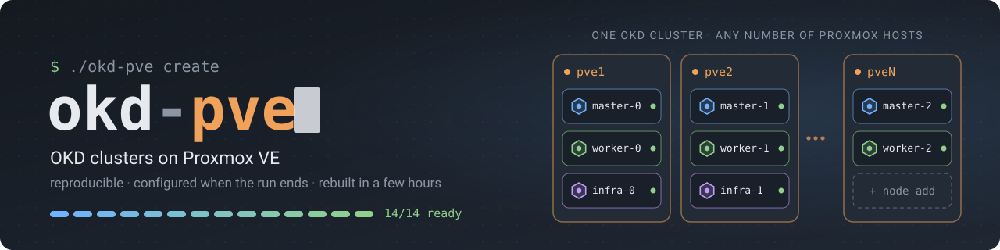
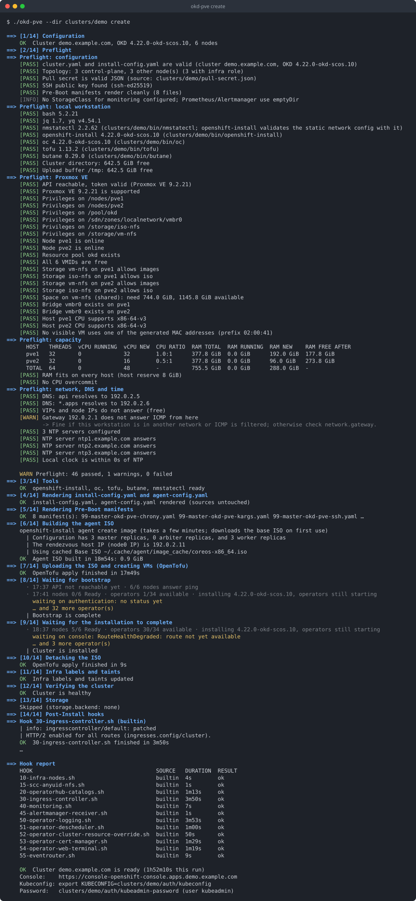
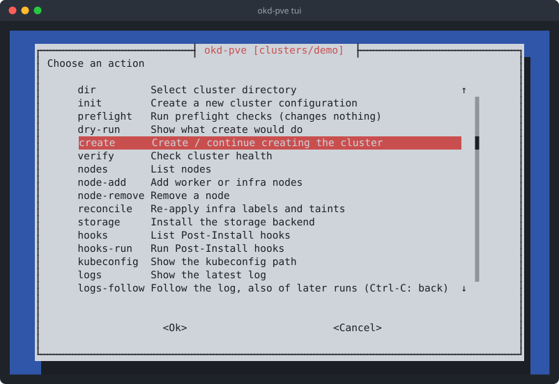

<!-- SPDX-License-Identifier: AGPL-3.0-or-later -->


# okd-proxmox

[](https://github.com/kellerkoenig/okd-proxmox/actions/workflows/ci.yaml)
[](https://github.com/kellerkoenig/okd-proxmox/releases)
[](LICENSE)
[](https://api.reuse.software/info/github.com/kellerkoenig/okd-proxmox)
[](https://scorecard.dev/viewer/?uri=github.com/kellerkoenig/okd-proxmox)
[](https://www.bestpractices.dev/projects/16288)
[](https://okd.io)
[](https://www.proxmox.com/en/products/proxmox-virtual-environment/overview)
[](https://opentofu.org)
[](https://www.gnu.org/software/bash/)

`okd-pve` builds [OKD](https://okd.io) clusters on Proxmox VE: reproducibly,
without clicking, and already configured for operation when the run ends.
You can throw a cluster away and rebuild it identically within a few hours.

There is no installer-provisioned infrastructure (IPI) for Proxmox. `okd-pve`
closes that gap by combining the **OKD agent-based installer** with
**OpenTofu** for the VMs and hiding both behind one CLI:

```text
okd-pve init mycluster        # commented configuration skeleton
okd-pve preflight             # checks everything, changes nothing
okd-pve create                # ISO, VMs, installation, labels, storage, hooks
okd-pve verify                # cluster health
okd-pve node add --role worker --count 2
okd-pve destroy
```

- [What it does](#what-it-does)
- [Limits](#limits)
- [Requirements](#requirements)
- [Quick start](#quick-start)
- [Configuration](#configuration)
- [Commands](#commands)
- [Troubleshooting](#troubleshooting)
- [Development](#development)
- [License](#license)

## What it does

1. Validates `install-config.yaml`, `cluster.yaml` and `proxmox.conf`.
2. Runs the preflight checks (Proxmox privileges, storage, bridge, VMIDs,
   MACs, capacity, DNS, VIPs, NTP, local clock).
3. Provides `openshift-install`, `oc`, `tofu` and `butane` in matching
   versions. Tools already in `$PATH` are used first. Missing ones are
   downloaded after you confirm, with checksum verification.
4. Renders `install-config.yaml` and `agent-config.yaml` (static IPs, fixed
   MACs, root disk by serial) into a fresh `.generated/` directory. Your
   source files are never touched or consumed.
5. Renders the **Pre-Boot** manifests (chrony, kubelet garbage collection
   for master *and* worker, kernel arguments, CA trust, infra pool,
   optional registry mirrors) into the ISO.
6. Builds the agent ISO with `openshift-install agent create image`.
7. Uploads the ISO and creates the VMs with OpenTofu: deterministic VMIDs and
   MACs, disk serials, control plane spread over Proxmox hosts, QEMU guest
   agent (switchable), serial console, all VMs in one resource pool.
8. Follows the installation (`wait-for bootstrap-complete` and
   `wait-for install-complete`) with readable progress output.
9. Detaches the ISO, labels and taints infra nodes, and verifies the cluster.
10. Installs the storage backend (Proxmox CSI, Ceph CSI, LSO/ODF or NFS) and
    proves it with a test PVC.
11. Runs the **Post-Install** hooks (ingress placement, monitoring,
    operators, ...) and prints a hook report.

`create` is idempotent. When it is interrupted, by Ctrl-C, a timeout or a
failed hook, the next run continues where it stopped.

A complete run (example values, shortened):



## Limits

Please read this before you plan with it.

- **No Machine API, no MachineSets, no autoscaling.** Proxmox has no
  installer platform in OKD. Nodes are plain VMs; scale with
  `okd-pve node add` / `node remove`.
- **No disconnected installation.** The cluster needs access to the image
  registries (quay.io, and registry.redhat.io when you use Red Hat catalogs).
- **No cluster upgrades, no etcd backup/restore.** Use the regular OKD
  mechanisms for that.
- One cluster per cluster directory. IPv4 only, one NIC per node.
- OKD 4.17 or newer (scaling uses `oc adm node-image`, available from 4.17).
- Single-node clusters use `platform: none` (the agent installer does not
  support baremetal VIPs with one node).

## Requirements

Workstation (Linux; macOS works for most commands but is not tested):

| Tool | Notes |
|---|---|
| bash ≥ 4.4, curl, awk, sed, tar | |
| `jq`, `yq` (mikefarah v4, >= 4.45) | required to read the configuration; CI tests the oldest supported yq too |
| `nmstatectl` | `openshift-install` validates static network configuration with it. `dnf install nmstate`; where no package exists (e.g. Ubuntu), `create` extracts it from the CentOS Stream 9 package with podman or docker |
| `unzip` | only to download OpenTofu |
| `whiptail` or `dialog` | only for `okd-pve tui` |
| `openshift-install`, `oc`, `tofu`, `butane` | downloaded into `<cluster>/bin` if missing |

Proxmox VE 8 or 9, and an API token with the privileges described in
[docs/proxmox-permissions.md](docs/proxmox-permissions.md). The token needs
neither `root@pam` nor SSH access to the Proxmox nodes.

Network: DNS records `api.<cluster>.<domain>` → API VIP and
`*.apps.<cluster>.<domain>` → ingress VIP, free addresses for the VIPs and
nodes, and at least three NTP servers reachable from the nodes.

## Quick start

```bash
git clone <this repository> okd-proxmox && cd okd-proxmox
./okd-pve init lab                     # creates clusters/lab/
$EDITOR clusters/lab/install-config.yaml   # baseDomain, VIPs, machineNetwork
$EDITOR clusters/lab/cluster.yaml          # Proxmox nodes, storage, node groups, IPs
$EDITOR clusters/lab/proxmox.conf          # API token (see docs/proxmox-permissions.md)

./okd-pve preflight                    # fix every FAIL
./okd-pve --dry-run create             # see what would happen, incl. tofu plan
./okd-pve create
export KUBECONFIG=$(./okd-pve kubeconfig)
```

When `./clusters/` contains exactly one cluster, commands find it on their
own; otherwise pass `--dir clusters/<name>`.

Two complete example configurations are in [examples/](examples/): a small
cluster with combined worker/infra nodes and a larger one with dedicated
infra nodes.

## Configuration

Three files per cluster, separated by confidentiality:

| File | Content | Secret? |
|---|---|---|
| `install-config.yaml` | Standard OKD format, unchanged. Must use `platform: baremetal` with `apiVIPs`/`ingressVIPs` (no BMC data). `okd-pve` validates it and fills replicas, pull secret and SSH key into a generated copy. | only if you put the pull secret in |
| `cluster.yaml` | Everything Proxmox-specific and the node topology. Commented template from `okd-pve init`; defaults in [templates/cluster-defaults.yaml](templates/cluster-defaults.yaml). | no |
| `proxmox.conf` | Credentials only, `KEY=value`, sourced. Refused when readable by group/others. Environment variables with the same names win (CI). | yes |

```bash
# proxmox.conf
PROXMOX_VE_ENDPOINT="https://pve.example.com:8006/"
PROXMOX_VE_API_TOKEN="terraform-okd@pve!okd=xxxxxxxx-..."
PROXMOX_VE_INSECURE="false"
```

The API token never appears in logs, error messages, OpenTofu output or
`--debug` traces: it is passed to curl through stdin and to OpenTofu through
the environment, and every output channel runs through a redaction filter.

### cluster.yaml at a glance

```yaml
okd:
  version: "4.21.0-okd-scos.11"     # OKD release tag; the SCOS version follows from it
proxmox:
  nodes: [pve1, pve2, pve3]         # control plane is spread round-robin (spread: true)
  vm_storage: local-lvm
  iso_storage: local
  bridge: vmbr0
  vlan_tag: 0
  pool: okd-lab                     # must exist
  vmid_start: 4100                  # VMID = vmid_start + group offset + index
  vmid_end: 4199
  mac_prefix: "02:00:00"            # MAC = prefix + VMID
network:
  gateway: 192.0.2.1
  dns_servers: [192.0.2.53]
  ntp_servers: [192.0.2.123, 192.0.2.124, 192.0.2.125]
  rendezvous_ip: 192.0.2.11
node_groups:
  - {name: master, roles: [master], count: 3, cpu: 8, memory_gib: 32, disk_gib: 120,
     ips: ["192.0.2.11-192.0.2.13"]}
  - {name: worker, roles: [worker, infra], taint_infra: false, count: 3, cpu: 8,
     memory_gib: 64, disk_gib: 256, ips: ["192.0.2.21-192.0.2.29"]}
infra: {taint_key: node-role.kubernetes.io/infra, taint_value: reserved}
storage: {backend: nfs, storage_class: nfs, nfs: {server: 192.0.2.200, path: /export/okd}}
monitoring: {storage_class: nfs}
hooks: {dir: ../private-hooks, builtin: [10-infra-nodes, 30-ingress-controller, 40-monitoring]}
```

The full reference with every key and its default is
[docs/configuration.md](docs/configuration.md).

### Roles

Node groups carry a *list* of roles: `master`, `worker`, `infra`. Infra nodes
are regular VMs that join as workers. `okd-pve` labels and taints them after
they joined, because there is no MachineSet. Dedicated (`roles: [infra]`) and
combined (`roles: [worker, infra]`) infra nodes are both supported.
`taint_infra` decides how they behave. See [docs/nodes.md](docs/nodes.md)
for the rules, the warnings and the migration from combined to dedicated
infra nodes.

### Pre-Boot and Post-Install

Configuration reaches the cluster in two ways. **Pre-Boot** manifests are
part of the ISO and effective at first boot. **Post-Install** hooks run
against the live API. Everything that creates a MachineConfig or
KubeletConfig belongs to Pre-Boot. Applied later, each one triggers a
rolling reboot. See
[docs/preboot-vs-post-install.md](docs/preboot-vs-post-install.md).

### Hooks

Numbered executables and `manifests/*.yaml` from two sources: the generic
examples in [hooks/](hooks/) and your private hooks directory (`--hooks-dir`
or `hooks.dir`). Both are merged and run in order, and on a name collision
the private one wins. Hooks source [lib/oclib.sh](lib/oclib.sh) for robust
waiting (`install_operator` waits for the CSV *and* the CRDs, for example).
See [docs/hooks.md](docs/hooks.md).

### Scope: platform, not applications

`okd-pve` covers platform configuration and operator deployment. Application
deployments stay with your deployment automation (Puppet, Argo CD, ...).
The boundary is where an operator is installed and given its base
configuration. The configuration *inside* it, such as concrete log
forwarding targets, issuers or namespace policies, belongs to the
deployment automation.

## Commands

| Command | Description |
|---|---|
| `init <cluster>` | Create `cluster.yaml`, `install-config.yaml`, `proxmox.conf` (mode 600), `preboot/`, `.gitignore` |
| `preflight` | All checks, `PASS`/`WARN`/`FAIL` with a hint each, capacity table. Changes nothing. |
| `create [--skip-preflight]` | Full cluster creation, resumable |
| `verify [--wait] [--timeout S]` | Nodes, MachineConfigPools, ClusterOperators, CSRs, VIPs, console, etcd, time sync, infra placement, registry mirrors, storage |
| `destroy` | VMs, disks, ISOs, state. Asks for the cluster name unless `--yes`. Keeps the configuration and logs. |
| `node add --role worker\|infra --count N [--group G]` | Node ISO via `oc adm node-image create`, new VMs (existing ones untouched), CSR approval, labels/taints |
| `node add --resume` | Finishes a `node add` that was interrupted (Ctrl+C, timeout): CSR approval, labels/taints, `count`, ISO cleanup |
| `node remove <name> [--drain-timeout 10m]` | cordon → drain → delete node → destroy only this VM. Refuses control-plane nodes without `--force-control-plane`. |
| `node list` / `node reconcile` | Inventory with VMID/host/IP/MAC/status / re-apply infra labels and taints |
| `storage install` | Deploy the configured storage backend |
| `mirrors apply` | Apply `registry_mirrors` (pull-through cache) to a running cluster: mirror sets, pull secret ([docs/registry-mirrors.md](docs/registry-mirrors.md)) |
| `hooks list` / `hooks run [name \| --from name]` | Show hooks with last result / run all, one, or from one on |
| `kubeconfig [--export]`, `logs [--installer] [-f]`, `tui`, `version` | |

Global flags: `--dir`, `--config`, `--hooks-dir`, `--dry-run` (works for
every changing command and shows the `tofu plan` and the hook list),
`--yes`, `--debug`, `--no-color`, `--log-file`.

Exit codes: `0` ok, `1` error, `2` configuration error, `3` preflight failed,
`4` hook failed.

`okd-pve tui` offers the same commands as a menu (whiptail or dialog). It
shows every command before running it and returns to the menu afterwards,
also after Ctrl-C:



Output goes to two channels: short progress on the terminal and the
complete log in `<cluster>/logs/`. Every run writes its own file
(`okd-pve-<command>-<date>-<time>.log`); `logs/latest.log` points to the
newest one. `okd-pve logs -f` follows the log and moves on to the next file
when a later run starts (e.g. a resumed `create`), which a `tail -f` on
`latest.log` does not (TUI: `logs-follow`; Ctrl-C returns to the menu).
`okd-pve logs --installer` shows openshift-install's own log.

During the long waits for bootstrap and installation, a status line every two
minutes shows Ready nodes, available operators and what the cluster still
waits for. openshift-install gives up after a fixed time, counted from when
it starts waiting rather than from when the cluster started installing; while
the cluster still makes progress, `create` waits again (with a warning)
instead of failing.

## Troubleshooting

| Symptom | Likely cause / next step |
|---|---|
| Proxmox Shutdown/Reboot of a node VM times out | The guest agent does not answer: the VM was not power-cycled since `proxmox.guest_agent` was enabled (Shutdown + Start in Proxmox), or the image has no agent (`guest_agent: false`). |
| `preflight` reports too little space in `/tmp` or `~/.cache` | openshift-install caches a ~1 GiB base ISO, and tool downloads need room in the temporary directory. Set `proxmox.tmp_dir` and `proxmox.cache_dir` to a larger filesystem, for example `.tmp` and `.cache` in the cluster directory. okd-pve uses them as `TMPDIR` and `XDG_CACHE_HOME` for itself and the tools it starts; no `export` needed. |
| ISO upload fails or takes long | okd-pve uploads the ISO with curl; it stops after `proxmox.upload_timeout` (default 3600 s) or when less than 10 KiB/s arrive for 5 minutes. The ~1 GiB ISO needs about 2.5 Mbit/s for one hour. Raise `upload_timeout` for a slow line, or run `okd-pve` from a host close to Proxmox. Running `create` again uploads again; an ISO already complete on the storage is skipped. (Up to 0.1.5 the OpenTofu provider ended every upload after 20 minutes with `context deadline exceeded`.) |
| VM does not boot, black console | CPU type: SCOS based on CentOS Stream 10 needs `x86-64-v3` or `host`. Check with `qm terminal <vmid>` (serial console). |
| Bootstrap stuck, hosts "insufficient" | `okd-pve logs --installer`; usually DNS, NTP or a disk/RAM below the minimum. The rendezvous node console shows the validation messages. |
| "openshift-install stopped waiting … after its fixed timeout" | The installation is usually still running, slowed down by image downloads (proxy, registry). Start `okd-pve create` again: it skips ISO and VMs and keeps waiting. If it times out again without progress, check the rendezvous node and the proxy throughput. |
| A worker or the rendezvous node never joins; for the rendezvous node etcd reports "2 healthy member(s) out of the 3 required" and authentication "need at least 3 kube-apiservers" | The agent installer has fixed stage timeouts (90 min "Waiting for control plane", 60 min "Waiting for controller"). With slow image downloads a host misses one and stays in the live ISO, although its disk is written: a worker that waited too long for the masters, or the rendezvous node, which waits for all other hosts. `create` detects this and resets the VM once (`recovery:` line in the status output), then approves its CSRs. With `install.recover_stuck_hosts: false`, or if the reset fails: reset the VM in Proxmox and approve the two CSRs of the node (`oc get csr`, `oc adm certificate approve <name>`). |
| "Cannot access Rendezvous Host" while the nodes answer ping | A firewall between your workstation and the cluster network blocks TCP 8090 (agent API); the installation itself continues. Check on the rendezvous node: `ssh core@<rendezvous-ip>`, then `curl http://127.0.0.1:8090/...`. Only the first `sshKey` is on the agent ISO; further keys reach the nodes after the installation. |
| The other masters wait for `https://<api-vip>:22623/config/master`, the rendezvous node runs the API but nothing answers on port 22623 | The bootstrap machine-config-controller crashes, so the Machine Config Server never starts. With registry mirrors and okd-pve 0.1.5 the cause was different `mirrorSourcePolicy` values in the ImageDigestMirrorSet and ImageTagMirrorSet (fixed in 0.1.6; see [docs/registry-mirrors.md](docs/registry-mirrors.md)). Otherwise read the container log `/var/log/pods/default_bootstrap-machine-config-operator-*/machine-config-controller/` on the rendezvous node (`install.debug_shell`). |
| Installation hangs and the rendezvous node does not answer SSH (masters wait for `https://<api-vip>:22623/config/master`) | The logs are only in the RAM of the live system. Set `install.debug_shell: true`, run `okd-pve destroy` and `create` again; if it hangs again, open the Proxmox console of the node, press Ctrl+Alt+F9 for a root shell and check `journalctl -u bootkube`, `crictl ps -a`. Set it back to `false` afterwards. See [docs/configuration.md](docs/configuration.md). |
| Failed `installer-<n>-...` pods in `openshift-kube-*` / `openshift-etcd` | Bootstrap race (e.g. `configmaps "client-ca" not found`); the operator rolled out a newer revision. `create` removes failed installer pods of revisions the node has replaced; failed pods of the current revision stay and need a look. |
| `Can't synchronise: no majority` | Fewer than three NTP sources, or they disagree. Pre-Boot chrony uses `network.ntp_servers`. |
| Certificates "not yet valid" on the nodes | Your workstation clock is off; certificates are created locally. Preflight checks this. |
| "configuration changed after the agent ISO was built" | A running installation cannot be re-rendered (new CA). Revert the change, or `destroy` and `create`. |
| MachineConfigPool `Degraded` | A node matches two custom pools. Combined worker/infra nodes must stay in the worker pool; see docs/nodes.md. |
| Hook failed | Fix it, then `okd-pve hooks run --from <hook>`. The hook report lists every hook with its result. |
| PVC binds a dynamic volume instead of your NFS PV | A default StorageClass is set; use `storageClassName: ""` in such PVCs (docs/storage.md). |
| VMs left over after a failure | All VMs are in the resource pool; `destroy` lists VMs of the cluster that are in the pool but not in the state. |

`--debug` adds a shell trace to the log file (secrets masked).

## Development

```bash
make tools   # pinned dev tools into .tools/: shfmt, yq, butane, tofu, tflint, bats
             # (shellcheck comes from your distribution)
make check   # shellcheck, shfmt, bats, tofu validate + tflint, leak check
```

Code is Bash (≥ 4.4, `set -euo pipefail`), shellcheck- and shfmt-clean. The
TUI only builds CLI command lines. Tests mock the Proxmox API, `oc`,
`openshift-install` and `tofu`. CI also checks that no real hostnames, IP
addresses, webhook URLs or tokens get into the repository
([scripts/check-leaks.sh](scripts/check-leaks.sh)): use `example.com` and
RFC 5737 addresses in examples.

Layout: `okd-pve` (entry point), `lib/` (all logic), `terraform/` (OpenTofu
module), `templates/` (init, Pre-Boot and storage templates, defaults),
`hooks/` (generic example hooks), `examples/`, `test/`, `docs/`.

How to contribute: [CONTRIBUTING.md](CONTRIBUTING.md). Security problems:
[SECURITY.md](SECURITY.md), never as a public issue. Every file carries
license information ([REUSE](https://reuse.software)); Renovate proposes
updates for the pinned tool versions and GitHub Actions. Pushing a tag
`vX.Y.Z` (matching `OKD_PVE_VERSION`) runs all checks and attaches a source
tarball, `SHA256SUMS` and the signed build provenance (`*.intoto.jsonl`) to
the release. To verify a tarball:
`gh attestation verify okd-proxmox-X.Y.Z.tar.gz --repo kellerkoenig/okd-proxmox`
(add `--bundle okd-proxmox-X.Y.Z.tar.gz.intoto.jsonl` to use the attached
provenance instead of the GitHub attestation API).

## License

Copyright (C) 2026 The okd-proxmox Authors.

This program is free software: you can redistribute it and/or modify it
under the terms of the GNU Affero General Public License as published by the
Free Software Foundation, either version 3 of the License, or (at your
option) any later version. See [LICENSE](LICENSE).
